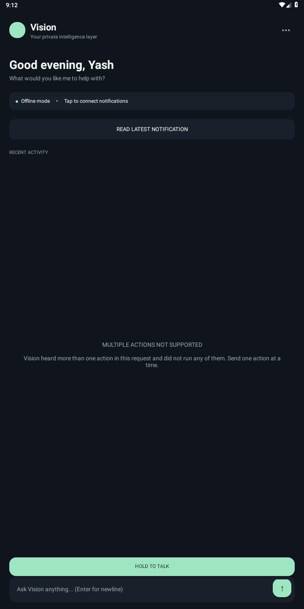

# Vision

An offline-first Android command assistant with a separate safety boundary between understanding a request and acting on it.

Vision handles supported phone commands locally. An optional, user-keyed cloud provider can propose actions for requests the offline parser does not understand. Proposals must pass strict validation; risky actions still require confirmation.

This is a bounded command assistant, not a general-purpose Jarvis, an always-on agent, or a bundled on-device language model.

## Why this project

A model can produce valid-looking instructions that are still wrong. Vision keeps action validation, Android permissions, confirmation and execution outside the model. The aim is useful phone actions with explicit limits and honest outcomes.

## Demo

A 70-second, captioned recording on an Android 9 emulator covers:

1. A real local action: `what time is it`.
2. A refused chained request: `open Telegram and then open Gmail`.
3. A calendar confirmation dismissed with Back: `create event Demo rehearsal tomorrow at 3 pm`.

The recording uses scripted Android instrumentation against unchanged app code, not a live cloud model or human-typing benchmark. [Watch or download the 70-second demo](docs/demo/vision-demo.mp4). See [capture notes](docs/DEMO_CAPTURE.md).

## What works in the current code

- **Local commands:** time, battery and network status; calendar reads; supported app launches; media, volume and torch controls; Clock and Maps handoffs. Results depend on device permissions, hardware and installed apps.
- **Communication boundaries:** replies to eligible captured notifications require confirmation. New direct messages open a prefilled composer after confirmation; opening a composer is not sending a message. Numeric calls open a dialer, never place the call.
- **Calendar and voice:** one-hour calendar event creation after confirmation; offline push-to-talk fills a reviewable text draft, not an automatically executed command. It requires available on-device speech recognition.
- **Optional cloud:** Groq, OpenRouter, OpenAI, Gemini or a custom HTTPS OpenAI-compatible endpoint. Adding a key enables fallback for unknown commands; ordinary validated actions can run without another proposal-review prompt. Risky confirmations remain. Provider usage may cost money.
- **Limited preferences:** separate opt-in for an encrypted, saved `response_style` preference with a 30-day expiry and view/delete controls. It changes battery/network/time wording, not action approval. Session-only preferences expire after 60 seconds.

## Architecture

```text
Typed command / reviewable voice draft
                |
        Deterministic parser
         | known       | unknown, cloud enabled
         |             v
         |       Optional provider proposal
         |             |
         |       Strict JSON + action/plan validation
         |             |
         +-------------+
                |
       Risk policy + Android permissions
                |
       Confirmation where required
                |
          Android action / handoff
                |
       Explicit result, refusal or cancellation
```

- `VisionActionParser` handles supported local grammar and bounded multi-action refusal.
- `ReasoningCoordinator`, `StrictJson`, `ReasoningProposalValidator` and `ReasoningPlanValidator` handle optional proposals. Model output cannot assign its own risk tier or approval.
- `VisionRiskPolicy` defines the automatic-action allowlist. Confirmation is the default for unlisted action types; invalid or unknown requests are not executed.
- `MainActivity` connects UI, permissions, lifecycle and dispatch. It still owns too much feature handling; separating it is future cleanup, not something this README claims is done.
- `VisionPlanExecutor` and managed-dialog handling bound plan lifetime and stop remaining work on cancellation. Already dispatched external actions cannot be undone.

## Screenshots

Actual emulator captures from the approved recording branch, with production code unchanged from the baseline:

  

These are real Android 9 emulator screens, not mockups. The app still contains hardcoded greeting/name text. Full originals and the confirmation capture are in [docs/demo](docs/demo).

## Verification

Current documentation baseline: main `6387cfca2383fce8a93ca7b92acaf57bdf793792` (app version `0.12.0`).

- [Linux and Windows checks](https://github.com/Yash1bajpai/vision_app/actions/runs/40640583526) passed unit-test/build/lint jobs on this commit.
- [Android emulator safety checks](https://github.com/Yash1bajpai/vision_app/actions/runs/40640583550) passed on this commit. The workflow requires exactly 15 passing instrumented tests, with no failures or skips. These cover selected key/preference, voice-lifecycle, dialog-cancellation, help, multi-action and clock-handoff wording paths.
- The [temporary demo capture run](https://github.com/Yash1bajpai/vision_app/actions/runs/40297383437) passed one dedicated Android instrumentation flow on capture commit `617134f` (no production-code changes from the baseline). It checked device time, refusal and Android Back cancellation. Calendar-write permission stayed denied throughout. This is new emulator evidence, not a real-phone or cloud test. The full original suite was not rerun by that dedicated flow. It does not prove every provider, OEM, microphone, battery or hardware-backed Keystore behavior.

## Known limitations

- Offline language handling is predefined grammar, not general understanding. The multi-action refusal detects bounded patterns; it is not a universal detector. The validated model-plan layer does not make arbitrary multi-step requests reliable.
- No bundled local model, general conversation memory or always-on background autonomy. Saved preferences are not assistant memory.
- A valid model proposal can still be the wrong action for the user's intent. Schema checks cannot establish semantic correctness. This offline demo does not prove live cloud-to-action reliability or the cloud Allow path.
- Notification access, runtime permissions, installed apps, available speech recognition and OEM behavior affect what works. Clock, Maps, dialer and composer handoffs do not prove a saved alarm, completed trip, placed call or delivered message.
- INTERNET permission is declared for optional cloud use. Cloud keys and optional response-style preferences can persist encrypted on the device. "Everything is offline" and "zero disk persistence" are not accurate descriptions of the current app.
- Tests cover specific inputs and lifecycle cases, not every natural-language request, device or failure. Real-phone microphone and battery behavior are not independently verified by this documentation update.

## Build and test

Requires JDK 17, Gradle 8.7, Android SDK platform 34 and build-tools 34.0.0. Minimum supported Android API is 26. This repository does not include a Gradle wrapper.

Set `ANDROID_HOME` and use your own SDK's `aapt2`; the tracked override is environment-specific. Configure an ignored `local.properties` with `sdk.dir` if needed.

```bash
# Linux / macOS shell with ANDROID_HOME set
gradle "-Pandroid.aapt2FromMavenOverride=$ANDROID_HOME/build-tools/34.0.0/aapt2" \
  testDebugUnitTest assembleDebug assembleDebugAndroidTest lintDebug

# With a booted, supported emulator or connected test device:
gradle "-Pandroid.aapt2FromMavenOverride=$ANDROID_HOME/build-tools/34.0.0/aapt2" \
  connectedDebugAndroidTest
```

On Windows, use the SDK's `aapt2.exe` path. Building androidTest APKs alone does not run the instrumented tests. See the workflow files for the verified CI setup.

## Implementation notes

- [Cloud setup, storage and limits](docs/CLOUD_OPT_IN.md)
- [Saved response-style preference](docs/SAVED_PREFERENCE_MEMORY.md)
- [Voice hardening](docs/VOICE_HARDENING.md)
- [Production checks](docs/PRODUCTION_CHECKS.md)
- [Historical implementation records](docs/IMPLEMENTATION_HISTORY.md)

Older records describe earlier versions and test totals. Use this opening and the linked current-main workflows for the current documentation baseline.
